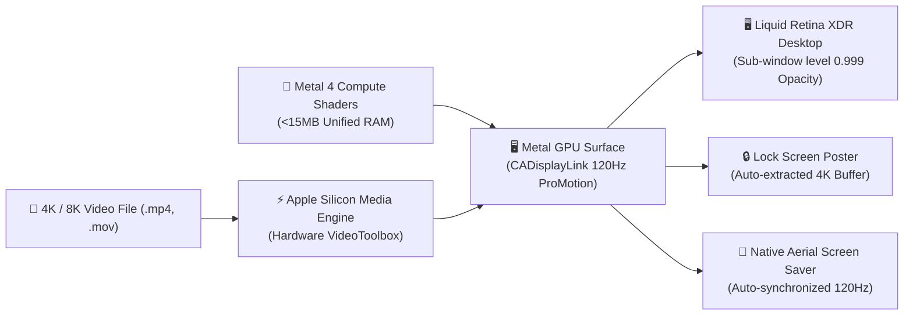

<p align="center">
  <h1 align="center">⚡ LiveWallpaper for macOS</h1>
  <p align="center">
    <strong>The ultimate 120Hz ProMotion Live Video Wallpaper, Native Metal Shader & Aerial Screen Saver Engine for macOS Apple Silicon (M1, M2, M3, M4).</strong>
  </p>
  <p align="center">
    Zero-copy hardware VideoToolbox decode &bull; &lt;15MB Metal compute shaders &bull; Sub-1% CPU usage &bull; Automatic Lock Screen &amp; Screen Saver synchronization.
  </p>
</p>

<p align="center">
  <a href="https://github.com/Vaathanaa/LiveWallpaper/releases/latest"></a>
  
  
  
  
  
  <a href="LICENSE"></a>
</p>

---

## ⚡ Quick Install

### Option 1: 1-Line Terminal Web Install (Fastest)

Open Terminal and run:

```bash
curl -fsSL https://raw.githubusercontent.com/Vaathanaa/LiveWallpaper/main/install.sh | bash
```

*Installs `LiveWallpaper.app` to `/Applications`, installs the native companion screen saver, clears Gatekeeper quarantine, and launches the app instantly into your menu bar.*

### Option 2: Guided Installer (`.pkg`) or Disk Image (`.dmg`)

- 📦 **[Download LiveWallpaper-Installer-1.2.0.pkg](https://github.com/Vaathanaa/LiveWallpaper/releases/latest)** — Guided double-click macOS installation wizard.
- 💽 **[Download LiveWallpaper-1.2.0.dmg](https://github.com/Vaathanaa/LiveWallpaper/releases/latest)** — Standard drag-and-drop disk image with `/Applications` shortcut.

### Option 3: Homebrew Cask

```bash
brew install --cask ./Casks/livewallpaper.rb
```

---

## 🌟 Why LiveWallpaper?

Most live wallpaper utilities on macOS are sluggish, memory-heavy Electron wrappers or ports of Windows apps that pin your CPU, drain battery within 2 hours, and cause stuttering.

**LiveWallpaper is engineered from the metal up in Swift, AppKit, Metal 4, and AVFoundation specifically for Apple Silicon.**



### Feature Comparison

| Feature | ⚡ LiveWallpaper | 🎮 Wallpaper Engine (Mac) | 📱 Generic Mac Wallpaper Apps |
| :--- | :---: | :---: | :---: |
| **Architecture** | **Native Apple Silicon (arm64)** | x86 Rosetta Emulation | Heavy Web/Electron Bloat |
| **DisplayLink Refresh** | **Locked 120Hz ProMotion & 200Hz+** | 30fps – 60fps | 30fps with micro-stutters |
| **CPU Usage** | **~0.5% (Hardware Decoded)** | 8% – 20% | 12% – 35% |
| **GPU Memory Footprint** | **&lt;15MB (Metal) / ~80MB (4K)** | 350MB – 1.2GB | 400MB – 800MB |
| **Screen Saver Auto-Sync** | **✔ Native 120Hz ScreenSaver** | ✘ Unsupported | ✘ Separate app required |
| **Lock Screen Poster Sync** | **✔ Instant zero-stutter poster** | ✘ Blank / Default | ✘ Requires manual screenshot |
| **Smart Battery Profile** | **✔ MagSafe 120Hz / Battery 60-24Hz** | ✘ Manual toggles | ✘ Battery drain issue |
| **iPhone Mirroring & PiP Safe** | **✔ Zero scanout plane glitch** | ✘ Video flicker | ✘ Hardware decoder contention |
| **Pricing & License** | **100% Free & Open Source (MIT)** | Paid / Steam DRM | Subscription Paywalls |
| **Privacy & Telemetry** | **Zero Telemetry / 100% Local** | Requires Steam Client | Network analytics tracking |

---

## 🚀 Key Features

### 1. Zero-Copy Hardware Video Engine
- Direct decode through Apple Silicon hardware Media Engines.
- Supports **4K and 8K HDR** `.mp4`, `.mov`, `.m4v`, and `.hevc` files.
- Non-exclusive compositing (`playerLayer.opacity = 0.999`) completely prevents scanout plane collisions with macOS Sequoia **iPhone Mirroring** and floating **Picture-in-Picture** video windows.

### 2. Apple Design Award (ADA) Studio & Precision Trimmer
- **Live Timeline Playhead & Scrubber**: Real-time scrubbing with instantaneous thumbnail feedback.
- **Precision In / Out Trimmer**: Define precise loop start and end boundaries with zero re-encoding.
- **Looping Modes**: Seamless 0ms hardware looper, smooth Crossfade Dissolve, and Ping-Pong reversal.
- **Cinematic Atmosphere**: Live Exposure (EV), Contrast, Saturation, Vignette, Frost Blur, and Dimming sliders.
- **Widget Readability Shield**: Ambient background shadow keeping desktop widgets and menu bars crisp on bright videos.
- **Dynamic Color Harmony**: Real-time palette extraction via CoreImage to adaptively tint UI accents.

### 3. Native Metal 4 Compute Shaders (&lt;15MB RAM)
- Standalone procedural raymarched shaders running entirely on GPU compute cores:
  - *Deep Space Nebula*
  - *Cyberpunk Matrix Rain*
  - *Minimalist Liquid Fluid*
  - *Northern Aurora*
- Consumes **under 15MB unified RAM** and **0.1% CPU**.

### 4. Flawless Lock Screen & 120Hz Screen Saver Synchronization
- Automatically extracts 4K wallpaper posters for the macOS Lock Screen whenever a wallpaper is applied or paused.
- Maps directly to macOS's official native aerial screensaver slots, looping your active live video at full 120Hz ProMotion quality during screen saver mode.
- On quit, automatically restores the default macOS desktop wallpaper and clears system caches cleanly.

### 5. Smart Battery & MagSafe Adaptivity
- Automatically tracks power source:
  - **Connected to MagSafe / AC**: Full 120Hz ProMotion smoothness.
  - **On Battery**: Intelligently throttles to 60fps or 24fps cinematic mode to maximize battery longevity.
  - **Low Power Mode / Heavy Apps**: Pauses automatically when heavy 3D games or Final Cut Pro render tasks run.
  - **Zero-Discharge Sleep**: Instantly purges video buffers when the lid closes or display sleeps.

### 6. Interactive 3D Mouse Parallax & Dynamic Depth
- Physically simulated spring-mass-damper inertia that responds to your cursor movement.
- Cursor safety cushions prevent parallax jitter near menu bars and screen corners.
- Automatically sleeps the render loop when the mouse is stationary (0.0% idle CPU).

---

## 💻 System Requirements

| Specification | Minimum | Recommended |
| :--- | :--- | :--- |
| **Operating System** | macOS 13.0 (Ventura) | macOS 14 (Sonoma) / macOS 15 (Sequoia) |
| **Processor** | Apple Silicon M1 (Base) | Apple Silicon M1/M2/M3/M4 (Pro / Max / Ultra) |
| **Display** | Any 60Hz Display | Liquid Retina XDR (120Hz ProMotion) or 144Hz+ Gaming Monitor |
| **Memory** | 8 GB Unified Memory | 8 GB – 128 GB Unified Memory |

---

## 🎮 Menu Bar Hub & Controls

LiveWallpaper lives unobtrusively in your macOS status bar (`play.desktopcomputer`):

- **Mini-Player Card**: Floating preview card with live scrubbing, timecode, and playback toggles.
- **Displays Tab**: Assign identical or independent video loops across all your external monitors.
- **Studio & Loop Tab**: Precision trimmer, loop fade controls, audio mute, and playback speed (0.25x slow-mo to 2.0x).
- **Atmosphere Tab**: Visual filters, contrast, saturation, vignette, and ambient widget shield.
- **Interactive & Shaders Tab**: Toggle procedural Metal compute shaders, particle overlays, and 3D parallax.
- **Playlist & Schedule Tab**: Auto-rotate through video playlists or schedule Day & Night wallpapers.
- **Performance Tab**: Battery threshold configuration, thermal throttling detection, and launch at login.

---

## ⌨️ CLI & Automation Commands

Integrate LiveWallpaper into **Raycast**, **Alfred**, or terminal shell scripts:

```bash
# Toggle Play / Pause
osascript -e 'tell application "LiveWallpaper" to activate'

# Switch Video via Distributed Notification
python3 -c "
from Foundation import NSDistributedNotificationCenter
center = NSDistributedNotificationCenter.defaultCenter()
center.postNotificationName_object_userInfo_('com.local.LiveWallpaper.loadVideo', None, {'path': '/path/to/video.mp4'}, True)
"

# Set Shader Mode
python3 -c "
from Foundation import NSDistributedNotificationCenter
center = NSDistributedNotificationCenter.defaultCenter()
center.postNotificationName_object_userInfo_('com.local.LiveWallpaper.setMode', None, {'type': 'metal', 'preset': 'matrix'}, True)
"
```

---

## ❓ Frequently Asked Questions (FAQ)

<details>
<summary><strong>Does running a live wallpaper drain MacBook battery life?</strong></summary>
<p>
No. When running on battery, LiveWallpaper's Smart Battery Engine automatically scales refresh rates down to 60fps or 24fps. Furthermore, when any window covers your desktop (full screen apps or overlapping windows), LiveWallpaper's occlusion detector automatically halts video rendering, dropping CPU and GPU consumption to exactly 0.0%.
</p>
</details>

<details>
<summary><strong>Does LiveWallpaper support multiple external monitors?</strong></summary>
<p>
Yes! LiveWallpaper supports two multi-monitor modes:
1. <strong>Synchronized Hardware Mode</strong>: Shares a single hardware decoder pipeline across all monitors, saving unified memory bandwidth.
2. <strong>Per-Display Mode</strong>: Assign unique video loops to each connected monitor independently.
</p>
</details>

<details>
<summary><strong>How does the Screen Saver and Lock Screen sync work?</strong></summary>
<p>
LiveWallpaper automatically extracts a pristine 4K frame to macOS's desktop cache so your Lock Screen displays the paused video image seamlessly with zero stutter. For the screen saver, it installs a matching companion screen saver bundle (<code>LiveWallpaper.saver</code>) that plays the active video when your Mac idles.
</p>
</details>

<details>
<summary><strong>Can I use videos with audio?</strong></summary>
<p>
Yes! Videos with audio tracks are supported. You can mute or unmute audio with one click in the menu bar, or adjust playback speed from 0.25x cinematic slow-motion up to 2.0x.
</p>
</details>

---

## 🤝 Contributing

Contributions from the community are warmly welcomed! Please read our [CONTRIBUTING.md](CONTRIBUTING.md) guide before opening a pull request.

To report bugs or suggest enhancements, please use our [GitHub Issue Templates](https://github.com/Vaathanaa/LiveWallpaper/issues/new/choose).

---

## 📜 Privacy & Security

LiveWallpaper is built with a strict **Privacy-First, Zero-Telemetry** commitment:
- 100% Local Processing — all video decoding and shader computation happens on-device.
- Hardened Runtime enabled with strict user-selected read-only sandbox entitlements.
- Zero analytics, zero logging, zero background tracking. Read our complete [Privacy Policy](PRIVACY.md).

---

## 📄 License

LiveWallpaper is open-source software released under the [MIT License](LICENSE).

<p align="center">
  <sub>Crafted with ❤️ for Apple Silicon &bull; If you love LiveWallpaper, please consider giving us a ⭐ on GitHub!</sub>
</p>
